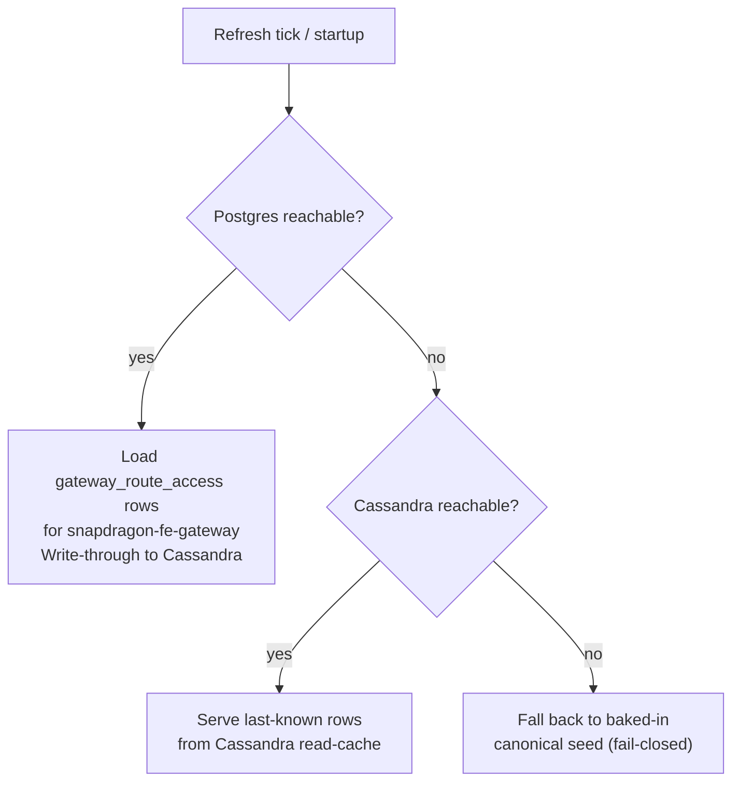
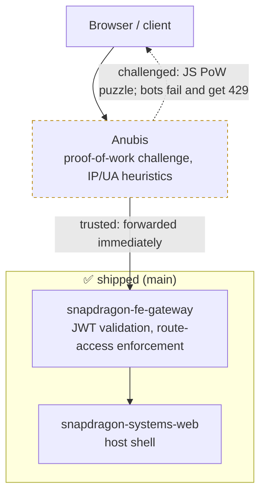

# snapdragon-fe-gateway

The **frontend front door** of a Snapdragon brand: the per-node-type instance of
the shared [snapdragon-gateway](https://github.com/Snapdragon-Systems/snapdragon-gateway)
Spring Cloud Gateway, deployed into the **frontend tier** in front of the web host
shell and its module-federation remotes (`snapdragon.systems` host + remotes).

This repo is **not its own service codebase**. It is a thin **overlay** that
re-uses the audited `snapdragon-gateway` image and changes only three things:

1. its **identity** — `SPRING_APPLICATION_NAME=snapdragon-fe-gateway`;
2. its **route set** — a single catch-all `Path=/**` route to the web frontend;
3. its **downstream URI** — the in-cluster frontend web service.

Everything else (the OAuth2 resource-server, the JWT→authority conversion, the
domain-scoping, the per-gateway route-access enforcement, revocation) is
**inherited unchanged** from the shared gateway image, so every device runs
identical, audited gateway code regardless of node type.

```bash
# GATEWAY_IMAGE must point at the sibling snapdragon-gateway image (CI passes the
# same-namespace tag automatically; see .gitlab-ci.yml). Default build-arg is
# snapdragon-systems/gateway:dev.
docker build -t snapdragon-systems/fe-gateway:dev .
```

---

## Current State

Shipped on `main` today:

- **Frontend-tier overlay is live.** The single catch-all `fe-default`
  (`Path=/**` → `snapdragon-systems-web`) route is seeded via Liquibase and
  configured under the **SCG 5.0 `spring.cloud.gateway.server.webflux.routes`**
  namespace (the legacy `spring.cloud.gateway.routes` prefix binds nothing under
  Spring Cloud Gateway 5.0 — see the SCG-5 note in `application-fe.yml`).
- **Pure Casdoor-JWT resource server.** This gateway exposes **no external
  login**; it only validates the internal Casdoor JWT and runs the inherited
  authority conversion + route-access enforcement (see below).
- **CI is GitLab** (in-cluster). There are no GitHub Actions workflows in this
  repo.

Ecosystem baseline this overlay inherits from the shared gateway image:

- **Spring Boot 4.0.7 / Spring Cloud 2025.1.2**. The shared gateway deliberately
  builds on `spring-boot-starter-parent:4.0.7` directly (**not** the BFF-focused
  `snapdragon-parent` metapom, which would drag in liquibase / testcontainers /
  r2dbc-postgres scaffolding the gateway's Cassandra-based suite does not use) and
  pulls in `snapdragon-commons` (shared security/tenancy,
  `systems.snapdragon.commons.*`, 2.7.0 — Boot-4 / Security-7 binary-compatible)
  as an explicit direct dependency.
- **Auth model.** Casdoor is the SSO IdP. `login-ui` drives a Casdoor OIDC
  authorization-code (PKCE) redirect and **`user-bff`** performs the server-side
  code→token exchange and holds per-session JWT custody/refresh; the browser only
  ever holds an **opaque `bff_`-prefixed session** and never sees its own Casdoor
  JWT. (Login/session/account logic is being **relocated from admin-bff to
  user-bff**, with the shared account/session/MFA/Casdoor-admin infra extracted
  to the new **`snapdragon-auth-core`** artifact; account/session **data** stays
  in `admin-bff-db`, reached over mTLS + `X-Internal-Token`.) The gateway stays a
  **pure Casdoor-JWT OAuth2 resource server**: a pre-security exchange filter in
  the shared image swaps the inbound `bff_` session → the internal custody JWT, so
  the gateway's JWT validation + role gate run unchanged on the frontend front
  door. This overlay carries none of that source and picks it up from the base
  image.

---

## Where it sits

| | |
|---|---|
| **Tier** | frontend (host + remotes front door) |
| **Namespace** | `snapdragon-frontend` |
| **Identity** | `snapdragon-fe-gateway` (the `gateway` key for its route-access rows) |
| **Downstream** | `snapdragon-systems-web.snapdragon-frontend.svc.cluster.local:80` (override `DOWNSTREAM_URI`) |
| **Auth** | validates the **internal Casdoor JWT** as an OAuth2 resource server; **no external login is exposed** (the shared image's pre-security filter exchanges the browser's opaque `bff_` session → custody JWT before validation) |
| **Base image** | `snapdragon-gateway` (one image, differentiated by `SPRING_APPLICATION_NAME`) |

A brand typically runs several gateway INSTANCES off this one image —
`snapdragon-fe-gateway` (this repo, the host + remotes front door),
`snapdragon-be-gateway` (backend / API + social homeservers), and
`snapdragon-pki-gateway` (identity: Casdoor + headscale) — each with its own
name, route set and route-access rows. This repo is the frontend one.

### What's in this repo

| File | Purpose |
|------|---------|
| `Dockerfile` | `FROM ${GATEWAY_IMAGE}` then bakes the fe identity + config + Liquibase changelog onto the shared image (sets `SPRING_APPLICATION_NAME` and `SPRING_CONFIG_ADDITIONAL_LOCATION`) |
| `application-fe.yml` | overlay config: `application.name`, the Casdoor `issuer-uri`, and the single `fe-default` `Path=/**` route to the web frontend (under the SCG 5.0 `spring.cloud.gateway.server.webflux.routes` namespace) |
| `liquibase/changelog/001-gateway-routes.xml` | seeds the `fe-default` route (`Path=/**` → `snapdragon-systems-web`) into the DB-backed `gateway_routes` registry |
| `liquibase/changelog/db.changelog-master.xml` | Liquibase master changelog that includes the route seed |
| `.gitlab-ci.yml` | builds + pushes this overlay image, basing the build off the sibling `snapdragon-gateway` image in the same in-cluster GitLab registry namespace |

CI is **GitLab** (in-cluster). There are no GitHub Actions workflows in this repo.

---

## Inherited capabilities (from `snapdragon-gateway`)

Because the image is the shared gateway, the fe-gateway gets the full gateway
authorization stack for free. The relevant pieces for the frontend front door:

### Opaque session → custody-JWT exchange

The browser behind this front door holds only an **opaque `bff_`-prefixed
session** — never a Casdoor JWT. A pre-security exchange filter in the shared
image swaps that `bff_` session for the internal **custody JWT** (minted/held by
`user-bff` after its server-side OIDC code→token exchange) **before** Spring
Security runs, so the entire JWT validation + authority conversion + route-access
stack below operates unchanged. The gateway itself exposes **no login** and never
performs the OIDC exchange.

### Casdoor resource server + role authorities

Every inbound request must carry a valid internal Casdoor JWT whose issuer matches
`CASDOOR_ISSUER_URI` (default `https://id.snapdragon.systems`). The shared
`CasdoorAuthorities` converter translates the validated token into Spring Security
authorities using these rules, applied in order:

- Every authenticated principal receives a `ROLE_USER` floor authority.
- Each entry in the `roles` claim maps to `ROLE_<UPPER>`, accommodating Casdoor's
  string-or-object role shape.
- Each entry in the `permissions` claim becomes a verbatim authority, **except** any
  entry beginning with the reserved prefixes `ROLE_` or `DOMAIN_` is silently
  dropped — this prevents token holders from injecting elevated authorities.
- A legacy `isAdmin: true` claim maps to `ROLE_ADMIN`.
- Exactly one `DOMAIN_<x>` authority is added, derived from the
  cryptographically-validated `iss` field — never from a user-settable claim.

The least-privilege cascade is `SUPERADMIN > ADMIN`/`MOD`/`USER`, plus the separate
`ROLE_IMAGE_BUILDER` capability.

### Domain scoping (multi-tenancy)

> Status: the issuer-keyed domain-scoping described here lands with the shared
> gateway's `feat/domain-foundation` work (`CasdoorAuthorities` /
> `DomainRegistry` / `Roles` / `GatewayRouteAccessFilter`). This overlay carries
> no source of its own and picks it up automatically from the base image.

`DomainRegistry` resolves the validated issuer to a brand/domain name. The mechanism
is **opt-in and backward-compatible**:

- With `APP_TENANCY_ISSUERS` unset, the single configured issuer maps to
  `DOMAIN_default` and the cluster behaves identically to single-tenant mode.
- With `APP_TENANCY_ISSUERS` set, only the explicitly listed per-brand Casdoor
  issuers are trusted. A token whose `iss` does not appear in the list **fails
  closed (401)**.

Once a domain is established from the validated issuer, `GatewayRouteAccessFilter`
**hard-denies** any non-`SUPERADMIN` principal whose domain does not match the
request's target domain. The domain is always derived from the cryptographically
validated `iss` — never from a user-settable claim — so this check cannot be
bypassed by crafting a token's authority entries. `ROLE_SUPERADMIN` is the **only**
cross-domain bypass, reserved for the infra control plane.

### Authorization filter chain

After Spring Security authenticates the JWT, the shared WebFilters execute in
this order:

| Order | Filter | Role in front of the web host |
|------:|--------|-------------------------------|
| +100 | `RevocationGatewayFilter` | reject revoked Casdoor tokens (Cassandra-cached) |
| +200 | `ExternalAuthHeaderFilter` | inject additive `External-Authorization` headers when an external-OAuth token is present (never required) |
| +250 | `GatewayRouteAccessFilter` | **per-gateway external-access rules** + the cross-domain hard-deny / `SUPERADMIN` bypass |
| +300 | `ResourceAccessFilter` | fine-grained per-resource grants (`{kind}:{id}`) for services that register them |

`ROLE_ADMIN` on the internal JWT bypasses the access filters **within its own
domain**, so the admin who manages the rules is never locked out.
Infra/observability paths (`/actuator/**`, …) stay gated to `ADMIN` /
`SUPERADMIN` by the shared `SecurityConfig`.

### Per-gateway route access

`GatewayRouteAccessService` enforces the admin-managed "which roles/users may reach
which URLs from outside **this** gateway" rules. **Postgres is the source of truth**
(`ROUTE_ACCESS_R2DBC_URL`); the pod loads the `gateway_route_access` rows for its own
`spring.application.name` (= `snapdragon-fe-gateway`), write-through-mirrors them into
the Cassandra read-cache, and refreshes every tick. The fallback chain is strictly
ordered and **never silently fail-open**:



The admin-bff (`snapdragon-admin-bff-api`) CRUDs the canonical rows. Longest-matching
`url_pattern` wins; explicit `allow=false` denies; the `PUBLIC` sentinel permits
anonymous traffic. Route-access data access follows the platform standard — Spring
Data R2DBC reactive repositories, no raw SQL strings.

### MFA-required route enforcement (✅ inherited, ships dark)

> Status: ✅ shipped + tested in the shared gateway image; **feature-flagged dark
> (default off)**, not absent. Casdoor MFA adds a `gateway_route_access.mfa_required`
> flag, fail-closed, plus a `MFA_SATISFIED` authority derived from the BFF-written,
> freshness-validated `mfa_satisfied_at` claim, plus the D8 privileged-MFA floor that
> denies even a SUPERADMIN reaching an `mfa_required` surface without a fresh second
> factor. Both `app.mfa.enabled` and `app.mfa.enforce-privileged-floor` default
> `false` (ship-dark) — when off the gateway is byte-identical to its pre-MFA
> behaviour. Because the enforcement lives in the shared gateway image's route-access
> layer, fe-gateway already carries it; no change to this overlay is expected beyond
> flipping the flags and new route-access rows flowing from the admin-bff.

---

## Configuration

The env vars below are specific to this overlay. The full configuration reference
is documented in `snapdragon-gateway`.

| Env var | Default | Purpose |
|---------|---------|---------|
| `SPRING_APPLICATION_NAME` | `snapdragon-fe-gateway` | gateway identity + route-access `gateway` key (baked into the image) |
| `CASDOOR_ISSUER_URI` | `https://id.snapdragon.systems` | trusted Casdoor issuer for JWT validation |
| `DOWNSTREAM_URI` | `http://snapdragon-systems-web.snapdragon-frontend.svc.cluster.local:80` | the web frontend this gateway fronts |
| `APP_TENANCY_ISSUERS` | _(empty)_ | CSV `issuerUri=domain,…` — enables multi-brand mode (empty ⇒ single-tenant `default`) |
| `APP_TENANCY_HOSTS` | _(empty)_ | CSV `hostSuffix=domain,…` — defense-in-depth Host→domain map |
| `ROUTE_ACCESS_R2DBC_URL` | _(empty)_ | Postgres source-of-truth for route-access rows (empty ⇒ Cassandra-cache/seed only) |

---

## Known gaps

- **Unverified "fe" Spring profile activation** (`Dockerfile:9-15`) — this overlay
  ships `application-fe.yml`, which Spring Boot only picks up from
  `SPRING_CONFIG_ADDITIONAL_LOCATION` when profile `fe` is active. Nothing in this
  repo (Dockerfile, `application-fe.yml`) sets `SPRING_PROFILES_ACTIVE=fe`; it is
  assumed the base `snapdragon-gateway` image derives the active profile from
  `SPRING_APPLICATION_NAME` or an equivalent convention. This has not been
  confirmed against the `snapdragon-gateway` source — until it is, treat the
  Casdoor `issuer-uri` override and the `fe-default` route as **unverified to
  load at runtime**, not merely as an inherited-from-base-image assumption.

---

## Roadmap

Grounded in the platform roadmap. Items below are **designed / in-flight**, not
shipped on `main`. Most are inherited from the shared `snapdragon-gateway` image or
rendered by the `snapdragon-generator`, not added to this overlay:

- **SSO end-to-end live + e2e** (in progress) — the Casdoor OIDC + opaque-`bff_`
  session model wired through `login-ui` / `user-bff` / this gateway, with full
  e2e coverage.
- **MFA** (WebAuthn + TOTP + recovery; per-role defaults; step-up) — the
  platform-wide enrollment/step-up work is in flight, but the **gateway surface is
  already shipped + tested** in the base image (the `gateway_route_access.mfa_required`
  flag + `MFA_SATISFIED` authority + privileged-MFA floor, see above); it ships dark
  and is enabled by flipping `app.mfa.enabled` / `app.mfa.enforce-privileged-floor`.
- **Anubis bot-challenge layer** at the edge (proof-of-work pre-auth friction) —
  detailed below; manifests would live in `snapdragon-generator`, not this repo.
- **Cloudflare** fronts prod.
- Platform-wide (not gateway-specific): encrypted versioned backups (Velero +
  kopia/restic), egress VPN (.conf drop-in), per-node attached storage, desktop
  app governance, workload console, device-license registry, multi-tenancy
  superadmin (per-domain CA + per-brand gateway/BFF/UI), games app-store, A/V via
  coturn/TURN, OWASP pen-test + nuclei in CI, binhost auto-update fleet
  distribution.

### Anubis bot-challenge layer (🔭 planned)

> **Status: 🔭 planned — not implemented in this repo, and not in the shared
> `snapdragon-gateway` base image either.** No Anubis container, manifest, or
> config ships here today; this section is design intent only. Because this
> overlay carries no Kubernetes manifests of its own, the sidecar and its
> Service/Ingress wiring would live in the **`snapdragon-generator`** repo (the
> deployed source of truth that renders the cluster manifests) — see the
> qualified paths in the checklist below.

[Anubis](https://anubis.techaro.lol/) is a proof-of-work HTTP challenge middleware designed to
block AI scrapers, credential-stuffers, and brute-force bots before they reach any upstream
service. The plan is to insert it as a transparent reverse proxy in front of this gateway so
suspicious traffic is challenged at the edge, not inside the JWT-validated gateway stack.

#### Architecture

The dashed node is the 🔭 planned Anubis layer; the boxed nodes are the
✅ shipped `fe-gateway → web-host` path that runs today.



Anubis would run as a sidecar container in the same `snapdragon-frontend` namespace, so the
fe-gateway's TCP port is never exposed directly to the cluster ingress.

#### Deployment shape

Per the platform roadmap, the intended rollout is **shields-up / enabled by default in
PROD** and **disabled in the TEST environment** (so e2e/QEMU runs aren't PoW-throttled),
with a **superadmin admin console** exposing the challenge's status + metrics.

#### Implementation checklist

> All file paths below live in the **`snapdragon-generator`** repo, **not** this overlay
> repo. This repo has no `specs/` directory, no k8s manifests, and no `verify-client.sh`;
> the Anubis sidecar would be added to the generator-rendered frontend manifests.

- [ ] Add `anubis/anubis:latest` container to the generator's
      `specs/cluster/manifests/frontend/deployment.yaml`
      (sidecar: listens on 8929, forwards to `localhost:8080` = the fe-gateway container port)
- [ ] Update the fe-gateway Service / Ingress (generator-rendered) to point at port 8929
      (Anubis) instead of 8080
- [ ] Wire `ANUBIS_BIND=:8929` and `ANUBIS_TARGET=http://localhost:8080` via ConfigMap
- [ ] Configure `ANUBIS_DIFFICULTY` (default 5 — proof-of-work iterations; tune to challenge
      cost vs. legitimate-user friction tradeoff)
- [ ] Add bot-signature rules (`ANUBIS_BOTS_POLICY`) for known scraper UA patterns
- [ ] Default-on in PROD, off in TEST (per roadmap); operators disable via
      `ANUBIS_DIFFICULTY=0` / policy file to NO-OP challenges
- [ ] Surface challenge status + metrics in the superadmin admin console
- [ ] Validate that `/api/auth/**` + `/actuator/health` bypass the challenge (Anubis supports
      path exemptions via its policy config — the fe-gateway's public auth paths must be exempt
      so the login flow isn't challenged before a user has any JS context)
- [ ] Add QEMU/e2e regression: the generator's `verify-client.sh` should confirm the
      fe-gateway reachable through Anubis after a clean login (a PoW-failed early abort shows
      as a 429 mid-test)

#### Security notes

- Anubis is **not a WAF** and does not replace the gateway's JWT or route-access
  enforcement. It is purely a pre-authentication friction layer at the network edge.
- Once the browser holds a valid session token, Anubis does not re-challenge
  authenticated API calls — that is intentional. Re-challenging every API request
  would break the SPA. The PoW challenge fires only on unauthenticated or
  unrecognized clients.
- Public paths (registration, login callback) must be exempted so that the login
  flow does not PoW-loop before the user has a JS context to solve a puzzle.

---

## Relationship to the platform

- **Gateways** — one shared `snapdragon-gateway` image; this overlay is its frontend
  instance. The be-gateway and identity (pki) gateway are siblings off the same image
  (and, only when the optional games service is enabled — off by default — a games
  gateway is rendered the same way).
- **Casdoor** — the gateway is a resource server only; it validates JWTs minted by the
  brand's Casdoor (fronted by the pki-gateway) and never exposes a login. The browser-facing
  login flow is owned by `login-ui` + `user-bff`; this gateway only ever sees the opaque
  `bff_` session (exchanged to the custody JWT by the shared image's pre-security filter).
- **Federation** — the host shell behind this gateway is the module-federation host;
  the same domain-scoping and route-access rows that gate ordinary traffic also gate
  federated/remote surfaces, with `SUPERADMIN` the only cross-domain reach.
- **Multi-tenancy** — per-brand instances each carry their own issuer + `gateway`
  name + route-access rows; the issuer-keyed `DOMAIN_<x>` scoping + the cross-domain
  hard-deny enforce brand isolation at the gateway.

The route table and per-instance config that actually run in the cluster are rendered
by the generator's ArgoCD Application (shared `snapdragon-gateway` Helm chart with
`instance.name: snapdragon-fe-gateway` + the fe `routes`); the admin-bff CRUDs the
`gateway_route_access` rows. This repo's `application-fe.yml` and `liquibase/changelog`
are the standalone/local-dev mirror of that same identity — keep them in sync with the
generator Application, which stays the deployed source of truth.

Note the scope of the changelog here: `001-gateway-routes.xml` seeds **only** the
single `fe-default` row into `gateway_routes`. It seeds **no** `gateway_route_access`
rows — those are CRUDed by the admin-bff at runtime (or supplied by the base image's
canonical seed), never baked in by this overlay.
